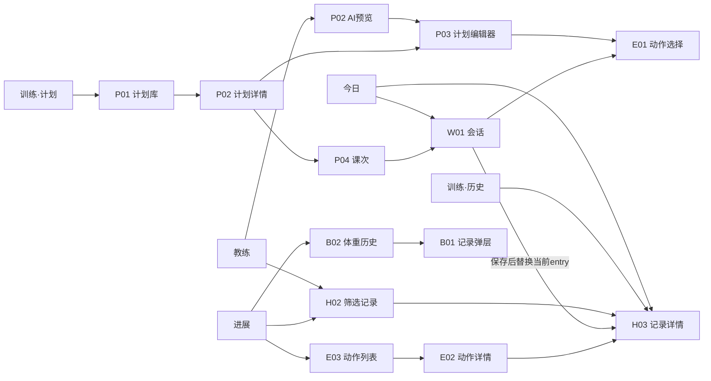
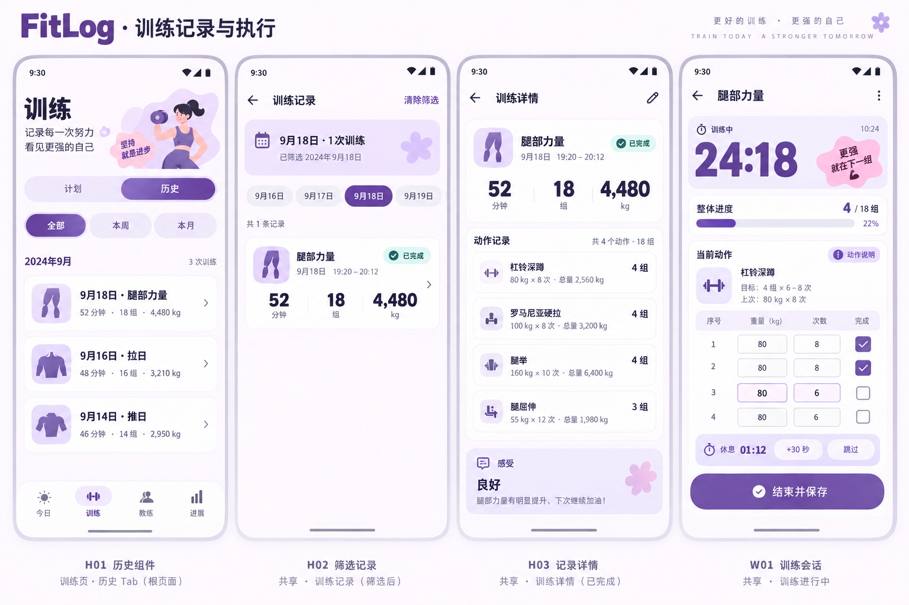
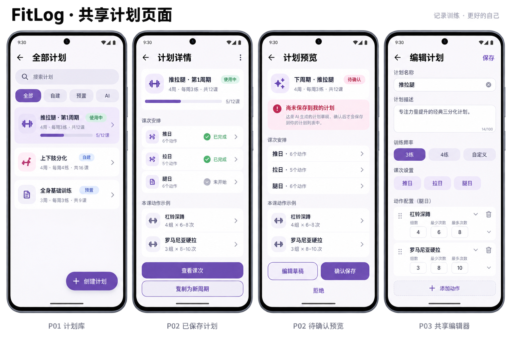
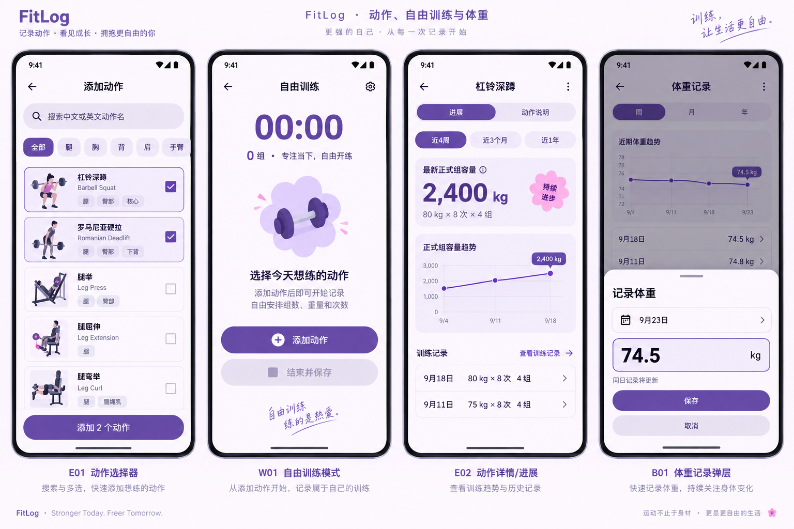
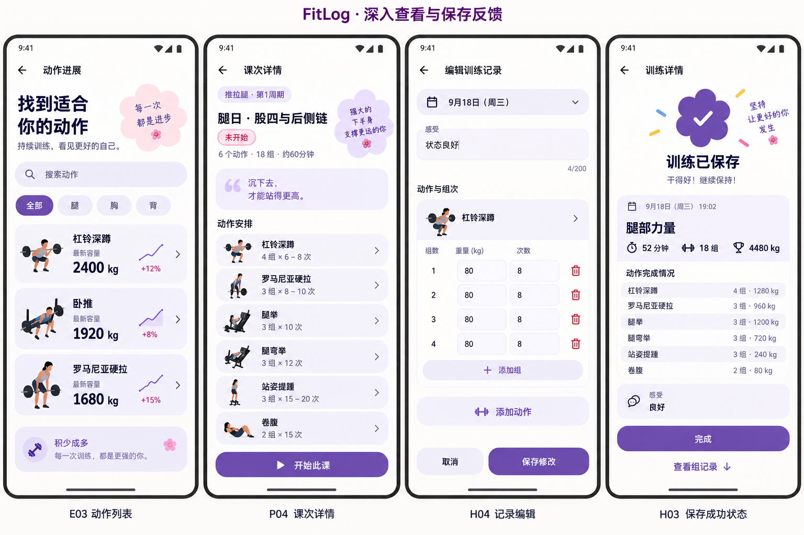

# FitLog 二级页面复用、点击行为与导航设计
日期：2026-09-23
状态：设计提案，尚未实现这些新路由。本次仅交付设计图与规格，不改应用代码。
依据：用户提供的四张参考图（教练、进展、两张训练主页），feat 现有 Today 与相关导航/UI。图中数据均为演示数据。

## 1. 复用边界
以业务对象和操作任务复用，不按“来自哪个 tab”复制页面。相同页面可以有不同初始筛选、模式和返回来源。
不把计划目标、进行中会话、已保存记录塞进同一个状态不明的万能页面。

| 标识 | 页面或组件 | 复用入口 | 差异参数 |
|---|---|---|---|
| H01 | WorkoutHistoryContent 历史内容 | 训练的历史分区；H02 筛选记录页 | 日期范围、动作ID、证据集合ID |
| H02 | WorkoutHistoryRoute 筛选记录页 | 教练查看记录；进展查看当日/区间训练；今日周历 | 过滤条件与范围说明 |
| H03 | WorkoutDetailRoute 只读记录详情 | 今日最近完成；历史行；教练证据；动作趋势；结束训练反馈 | workoutId；保存成功一次性反馈 |
| H04 | WorkoutEditRoute 历史编辑 | H03 编辑 | workoutId、独立草稿 |
| P01 | PlanLibraryRoute 计划库 | 训练“我的计划·查看全部”；今日选择计划 | 浏览/选择模式 |
| P02 | PlanDetailContent + 详情路由 | 训练查看计划；计划库；教练查看完整计划 | 已保存计划引用 / AI proposal 引用 |
| P03 | PlanEditorRoute 共享编辑器 | 创建计划、修改、复制、新周期、AI编辑草稿 | draftId；草稿来源决定提交行为 |
| P04 | SessionPrescriptionRoute 课次处方 | 计划课次行；AI完整计划中的课次行 | planId+sessionId 或 proposalId+revision+sessionId |
| W01 | ActiveWorkoutRoute 会话页 | 今日继续训练；训练自由训练；课次开始 | workoutId；目标快照可为空 |
| E01 | ExercisePickerContent | 计划编辑、会话添加动作、历史编辑 | pickerRequestId、单/多选；返回稳定动作ID |
| E02 | ExerciseDetailRoute 动作详情 | 进展动作卡；动作选择器信息按钮；处方动作行 | exerciseId、初始页签 进展/说明 |
| E03 | ExerciseProgressListRoute | 进展“动作进展·查看全部” | 时间范围；仅显示有对应记录的动作 |
| B01 | WeightRecordSheet 体重录入弹层 | 进展“记录”；体重历史新增/编辑 | 日期、已有值 |
| B02 | BodyWeightHistoryRoute | 进展体重卡主体 | 时间范围 |

H01 是可嵌入内容，不必再造一套“训练历史页面”；H02 提供独立返回栈和范围标题。
P02/P03 复用视觉与字段校验，但已保存计划和 AI proposal 使用不同数据加载与提交适配层。
H04 与 W01 复用组输入行、数值校验、动作选择；不共用保存语义、计时状态或 ViewModel。
E01/E03 复用动作列表行与检索组件，不把选择器和历史趋势列表强行合并。
B01 用弹层完成短表单；P03/H04 使用全屏编辑，给键盘和大字体留空间。

## 2. 每个入口的点击行为
### 今日
| 热区 | 结果 |
|---|---|
| 头像 | 设置 |
| Coach Insight 整卡 / 和教练聊聊 | 切到教练 tab，附可见训练上下文与输入框草稿；不自动发送请求 |
| 进行中主卡主体 / 继续训练 | W01(workoutId)，两者同目标；按钮拥有独立触控语义，不重复触发 |
| 未开始主卡主体 | P04 查看下一课处方 |
| 未开始“开始训练” | 事务创建或恢复会话，成功后进入 W01；不是在 composition 中隐式创建 |
| 无计划“选择计划” | P01 选择模式；预览后明确启用 |
| 无计划“自由训练” | 创建或恢复自由会话，进入 W01；不隐式选择激活计划 |
| 当天完成主卡 / 最近完成卡 | H03(具体 workoutId)，不能泛跳历史列表 |
| 全周期完成 | P02；“开始新周期”创建独立草稿进入 P03，不覆盖旧周期 |
| 周历已训练日 | H02(date)，同日多次均可查看 |
| 周历今天未练 | 有会话进 W01，有下一课进 P04，否则提供选计划/自由训练 |
| 未来且无安排 / 无记录的过去日 | 不显示可点击箭头；不能猜测存在计划安排 |

### 训练
| 热区 | 结果 |
|---|---|
| 计划/历史分段 | 训练根页局部切换；保存各分区滚动位置，不新增 route |
| 创建计划 | 创建本地草稿 → P03(draftId) |
| 自由训练 | 无会话时创建 FREE 会话 → W01；已有会话时提示继续已有训练，不静默替换 |
| 当前计划主体 / 查看计划 | P02(planId) |
| 当前计划课次行 | P04；状态对应“开始此课 / 继续训练 / 查看已保存记录” |
| 我的计划行 | P02(planId)，不因点卡而启用计划 |
| 我的计划·查看全部 | P01，不是历史列表或动作列表 |
| 开始新周期 | 基于原计划建立新身份草稿 → P03 → 保存后显式启用 |
| 历史记录行 | H03(workoutId) |
| 删除记录 | 溢出菜单的独立动作，二次确认；卡片主体不兼做删除 |

### 教练
| 热区 | 结果 |
|---|---|
| 分析最近训练 | 选择范围/查看上下文，确认发送后产生回答 |
| 生成下周期计划 | 可见上下文 + 输入草稿，明确发送；生成结果只形成 proposal |
| 上下文“查看记录” | H02(evidenceSetId)，展示模型实际获得的记录，不重新按日期猜集合 |
| 回答中具体记录引用 | H03(workoutId)，引用必须有结构化ID；纯模型文字不自动变链接 |
| proposal 主体 / 查看完整计划 | P02(proposalId, revision)，只读预览 |
| proposal 课次行 | P04(proposalId, revision, sessionId) |
| 编辑草稿 | P03(draftId)，完成后写回 proposal 新修订并返回教练；不会直接成为训练计划 |
| 确认保存 | 对指定 proposal 修订执行一次应用；成功卡变为“已保存·查看计划” |
| 拒绝 | 标记 proposal 已拒绝，不写训练计划；恢复后状态一致 |
| 已保存·查看计划 | P02(回执中的 planId)；不能再次确认写入 |

证据集合应记录真实发送过的记录ID、范围和采集时间。记录后来修改/删除时提示证据已变化/记录已删除；
若尚无持久化证据集合能力，必须先补能力，不能把动态范围列表标成“AI 已看到的数据”。

### 进展
| 热区 | 结果 |
|---|---|
| 周/月/年 | 本页切换范围，重算选中点；不压栈 |
| 柱/折线数据点 | 先选中并显示日期、单位、数量，避免轻触图表立即跳页 |
| 查看当日 N 次训练 | H02(date)；按用户明确入口保持列表，即使 N=1 也不随机跳不同页面 |
| 月/年聚合桶下钻 | H02(startDate,endDate)，不能当成单日 |
| 训练次数/正式组数摘要 | 打开当前范围 H02；正式组数只作为展示口径，不虚构筛选条件 |
| 动作卡主体 / 查看重量次数与记录 | E02(exerciseId, tab=进展) |
| 动作进展·查看全部 | E03(range) |
| 体重卡主体 | B02 |
| 体重卡尾部“记录” | B01；与卡主体分离触控区域 |
| B02 历史值 | B01(date, value)；同日保存更新该日记录 |

## 3. 二级页内部动作
- P01 计划行进 P02；“启用”属于明确按钮，有当前会话时不得让会话目标随之改变。
- P02 已保存模式：显示来源/激活/完成状态；编辑预置计划时创建副本；完整周期可复制新周期。
- P02 草稿模式：显示“尚未保存”，提供编辑/确认/拒绝；不可开始训练或假装已经启用。
- P04 动作行进 E02(说明)；没有可信说明或图片时如实空态。AI 草稿课次只读，无开始训练按钮。
- W01 行内完成勾选先校验有效重量与次数；预填不是完成。完成正式组反馈进度，可触发休息。
- W01 返回只离开页面，训练继续保留；“放弃训练”在溢出菜单内确认；“结束并保存”验证后事务保存。
- W01 保存成功以 H03 替换当前会话 entry；返回不会重新进入已结束会话。保存失败留在 W01 并保留输入。
- H03 的“查看组记录”在本页滚动展开；不另造重复总结详情页。训练完成庆祝只是 H03 的一次性头部状态。
- H04 取消不写库；完成按钮禁重复提交；不能把已保存记录改成零个有效正式组。
- P03 添加动作打开 E01，组次字段显示清晰标签，排序用上移/下移；未保存返回询问“保留草稿 / 放弃修改 / 继续编辑”。
- E01 点击行选择，信息图标进 E02；选择完成后返回结果给原 draft/session，不能直接写错目标。
- E02 点趋势选择时间点，点具体训练记录进 H03；进展和说明是同对象不同页签。
- B01 保存失败保持输入；成功关闭并刷新所有体重展示。

## 4. Navigation3 连接设计（拟议，不是当前已实现 API）
继续项目已有 Navigation3，不照搬 skill 参考中的 Navigation Compose NavHost。
所有目的地 key 可序列化，只传稳定ID、枚举和小型筛选值；完整 Workout/Plan/可变草稿不放路由。

建议 key：
```kotlin
// 示意契约，暂不写入 app。
TrainingKey // 根页；计划/历史选择属于根页保存状态
WorkoutHistoryKey(filter) // All / DateRange / Exercise / EvidenceSet
WorkoutDetailKey(workoutId)
WorkoutEditKey(workoutId)
PlanLibraryKey(mode) // Browse / Select
PlanDetailKey(reference) // Saved(planId) / Proposal(proposalId, revision)
PlanEditorKey(draftId)
SessionPrescriptionKey(reference, sessionId)
ActiveWorkoutKey(workoutId)
ExercisePickerKey(requestId)
ExerciseDetailKey(exerciseId, initialTab)
ExerciseProgressListKey(range)
BodyWeightHistoryKey
// WeightRecordSheet 为当前 route 内的可恢复弹层状态。
```

### 栈与返回
1. 四个根 tab 各保留独立保存栈：今日 / 训练 / 教练 / 进展。
2. 跨 tab 进入共享详情时，推入发起方栈。例如 今日→H03→返回今日；教练→H02→H03→返回H02→教练。
3. 四根页面显示底部导航，二级详情、会话、编辑页隐藏底部导航，提供返回箭头。横屏/平板可将同一目的地映射到主从面板。
4. 切 tab 保存位置和草稿；重复点击当前 tab 不销毁编辑状态。不用 clear()+add() 切换导致丢失页面。
5. 系统返回先关闭弹层，再弹出当前栈；编辑脏状态统一拦截；根页遵循系统退出行为，绝不弹空栈。
6. 页面已位于栈顶且相同ID时不重复 push。防双击导航与业务写入幂等分别保证。
7. 开始训练是先执行业务操作再拿 workoutId 导航；恢复训练只读取ID。进程恢复 route 不能重新执行创建。
8. 编辑器返回结果传 draftId/revision 或结果事件；列表通过 repository Flow 刷新，不把整份新计划当导航返回参数。
9. 失效ID显示“记录已删除/计划不存在”与返回按钮；AI旧修订必须显示过期并重新加载，不能提交旧 payload。



## 5. 复用到什么层级
- 共享 domain 与 repository 查询：记录摘要/详情、计划引用、目标快照、完成组和容量口径。
- 共享 UI：WorkoutSummaryRow、WorkoutMetrics、ExercisePrescriptionRow、SetInputRow、ExercisePickerContent、PlanOverviewContent、ScopeHeader、EmptyState。
- 独立 route ViewModel：历史编辑、计划编辑、会话执行分别拥有事务和恢复规则。
- AI proposal 通过适配器投影到计划预览模型；提交携带 proposalId/revision；复用展示不等于共享副作用。
- 一次性保存反馈与错误使用独立事件通道；状态刷新由持久化事实驱动。

## 6. Material Expressive 视觉与交互规范
- 延续参考图暖白/淡紫 tonal surfaces、紫色大胶囊主按钮、强调字重、大数字和少量粉色辅助色。
- 分组列表连贯外轮廓，组内圆角适度；形状花瓣用于完成徽章，不给每行堆装饰。
- 普通业务卡不增加光晕；Today Coach Insight 保留流动光晕。AI草稿可以柔和粉紫识别色，但必须有待确认文字。
- 容器与内容使用配对语义色；深色/动态色由 token 映射，不把示例紫色当固定产品色。
- 关键触控至少48dp；200%字体允许卡片增高、主操作换行；输入页避开IME和系统栏。
- 当前数据、计划目标、历史参考用明确标签区分；完成不用颜色单独表达。
- 列表→详情保持对象标题/图标连续性；完成组短促形状/色彩反馈；遵循系统减少动画设置。
- 设计图是静态示意，不能证明动态动画、对比度、字体适配或实际运行效果。

## 7. 当前代码差距与落地顺序
已核对的当前事实：
- FitLogNavKeys.kt 中 WorkoutKey 只有 autoStart，无 workoutId/history/detail 路由。
- MainActivity.kt 的 Today 记录入口进入 WorkoutKey()，开始入口进入 WorkoutKey(autoStart=true)。
- WorkoutScreen.kt 有 activeSession 时取代历史列表；故当前不能保证查看指定历史记录。
- TodayScreen.kt 的 RecentWorkoutCard 使用无参 onLogClick，模型虽有 workoutId，点击未携带。
- MainActivity.kt 当前切 tab 清空单一 backStack；尚非四个独立栈。
- StatsScreen.kt 已有 WeightRecordSheet 可提取；图表/热力图未连接这里拟议的记录下钻路由。
- ChatScreen.kt 目前用 ToolConfirmationDialog(Boolean)；不等价于持久化 proposal 预览/编辑闭环。

最小落地顺序：
1. 分离 W01 与 H02/H03，让 Today 最近完成按ID跳详情，保留返回来源。
2. 提取 H01，训练历史分区与日期下钻共用；完成 H04 与保存结果状态。
3. 建立 P01/P02/P04，再接 P03 稳定草稿与目标快照；复用 E01。
4. 接 E03/E02 与进展筛选；提取 B01，增加 B02。
5. AI proposal/revision/receipt 持久化后接同一计划预览和编辑器；不能只做假确认UI。
6. 完成独立根栈、恢复及适配验收。

关键验收：
- 今日最近完成打开正确ID，哪怕另一训练仍在进行；返回仍到今日。
- 同日两次训练、AI证据子集和已删除证据均正确展示。
- 自由训练与计划会话不混目标；重复开始不创建第二会话。
- AI编辑保存只更新草稿；重复确认不重复建计划。
- 键盘、大字体、系统返回、旋转和进程恢复不丢草稿或错误重放写入。
- 不靠更换截图基线冒充视觉验收。

## 8. 设计图索引
- 01-history-session.png：历史分区、日期筛选记录、记录详情、训练会话。
- 02-plan-reuse.png：计划库、计划详情、AI预览、共享计划编辑器。
- 03-exercise-weight.png：动作选择、自由训练空态、动作进展详情、体重弹层。
- 04-detail-states.png：动作进展列表、课次详情、历史编辑、训练保存反馈。
- 图中文字或数值若与本规格冲突，以本规格为准；生成图不作为业务口径测试依据。

### 静态生成图校对备注
图01部分明细组数/容量与总览不一致，且年份生成成2024；这些为排版示意，实际年份应使用真实日期，容量必须由 VolumeAggregator 聚合。图03“80kg×8次×4组”应为2560kg，图中2400kg不应照抄。图04的保存反馈与编辑示例也不是同一套可验算数据。
图04“找到适合你的动作”建议实施时改为“回顾每一次进步”，以免将动作进展列表误解为推荐动作。
运动姿势插画仅为装饰占位，实现须使用项目可信目录素材，不能当动作指导依据。
图02以重新生成的最终版本为交付；初稿中的额外底栏和草稿已完成进度不采纳。





图02最终版的未开始课次应使用空心圆而非灰色勾；尚未保存提示使用中性信息色而非错误色。编辑器排序实现为明确上移/下移，图中的拖动手柄不作为首版交互要求。
